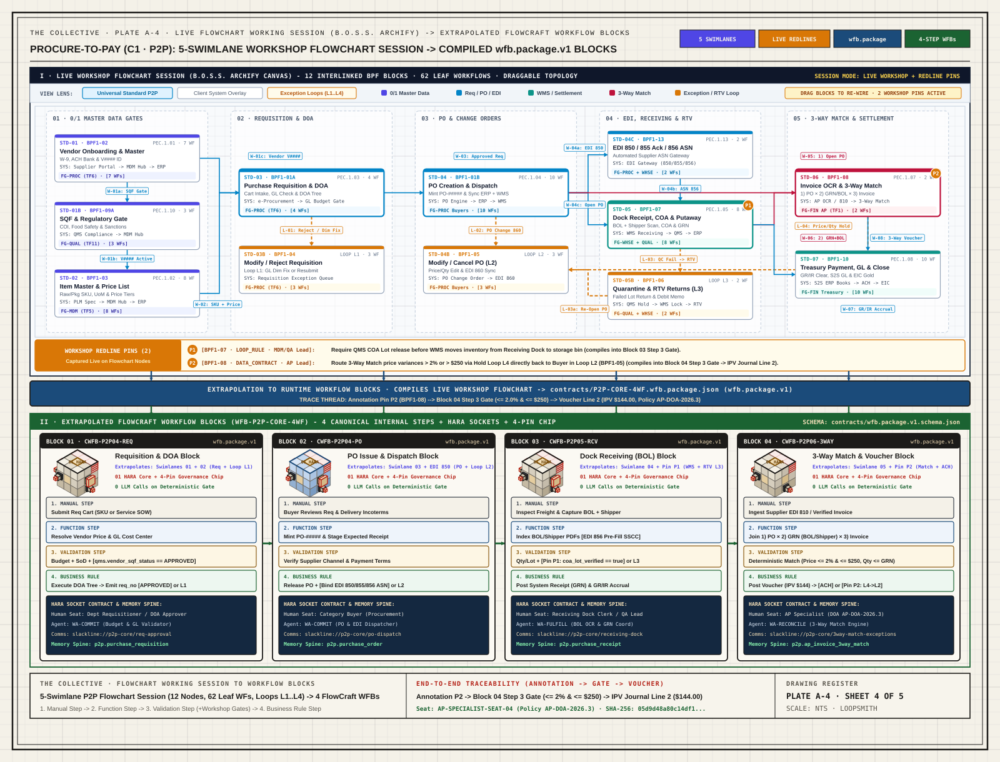
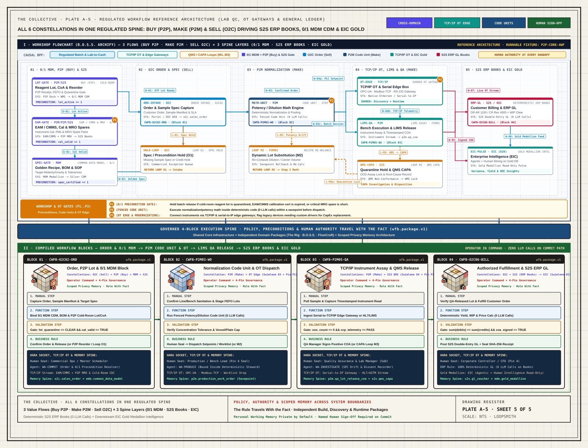
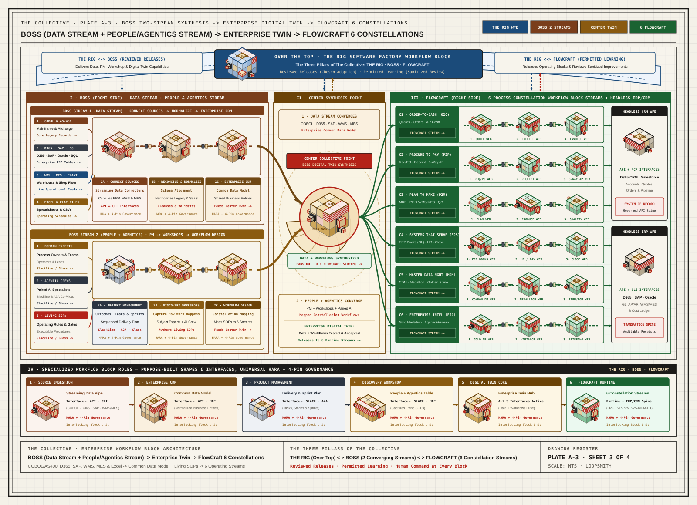
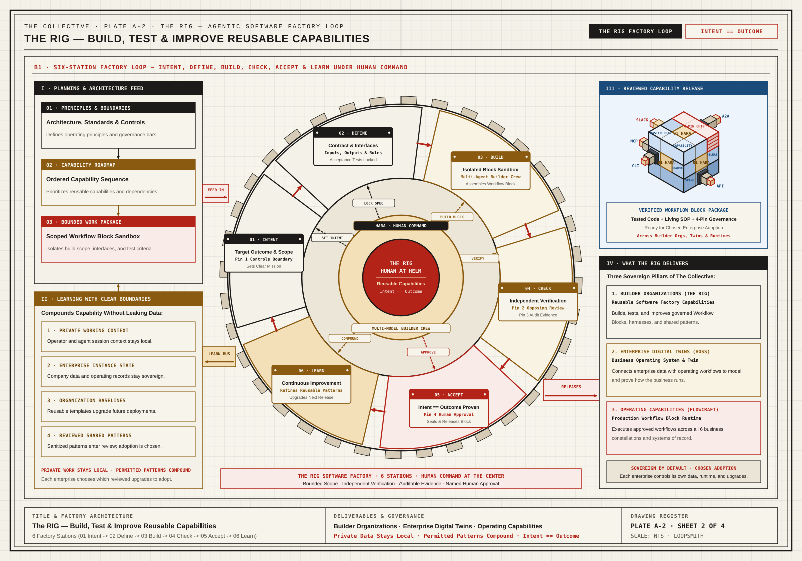
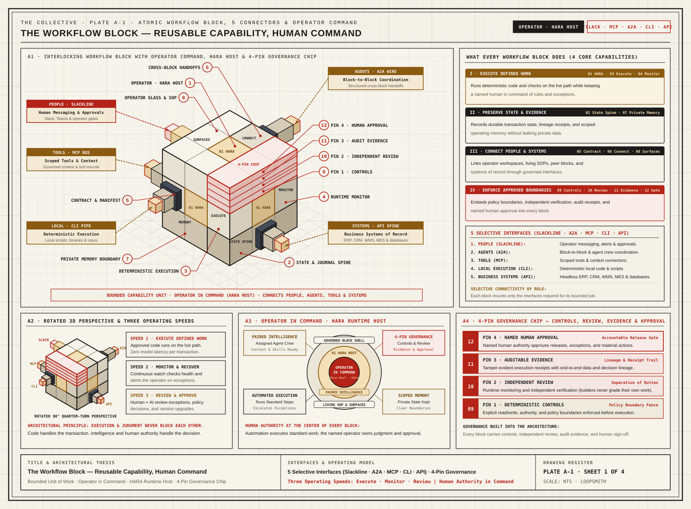

# The Collective

[](https://github.com/loop-smith/the-collective/actions/workflows/validate.yml) [](https://github.com/loop-smith/the-collective/blob/main/contracts/wfb.package.v1.schema.json)

**Deterministic workflow contracts and internal field tooling for the 20% of enterprise operations that standard ERP packages leave outside the core.**

**Robert Paddock** · Enterprise Transformation CIO/CTO · Full-cycle ERP, WMS/MES, and multi-entity finance implementations  
[Experience](https://idigdata.com/experience/?utm_source=github&utm_medium=the_collective_readme&utm_campaign=the_collective) · [Field notes on agentic AI](https://idigdata.com/agentic-ai/?utm_source=github&utm_medium=the_collective_readme&utm_campaign=the_collective) · [The Collective](https://idigdata.com/collective/?utm_source=github&utm_medium=the_collective_readme&utm_campaign=the_collective)

> **Why I built this:**  
> Across decades of enterprise implementations, I ran discovery, legacy data reconciliation, and production cutovers on spreadsheets, databases, and project management software because nothing existed for how cutovers actually run. Four years ago I started writing code every day with Claude, Codex, Gemini, and Grok to build my own internal field tooling (`The Rig`, `B.O.S.S.`, and `FlowCraft`). I opened this repository to publish the core `wfb.package.v1` workflow package contract, the five architectural plates that keep our internal builds on bearing, and one complete Procure-to-Pay exception loop with an executable validator.

---

## The problem, from the floor

Every enterprise implementation I have run stalls in the same place. The ERP, CRM, WMS, and MES cover roughly 80% of the business. The remaining 20% lives in email threads, spreadsheets, tribal knowledge, and exceptions nobody wrote down:

- The QA lead will not release received inventory to a storage bin until the Certificate of Analysis is verified, yet the WMS has no gate for it, so it happens by Slack.
- AP holds invoices with a unit-price variance over 2%, yet the hold goes to a shared inbox instead of back to the buyer's change-order queue, so it sits for three weeks.
- The GR/IR accrual and price-variance posting are correct in the GL only if someone remembered to key the receipt before month-end.

Coding agents can scaffold an application in minutes. They cannot know these rules, because the rules were never written down. That is the gap this tooling closes.

## The approach, in one sentence

**Propose in language. Admit by deterministic rule. Remember in the book.**

- LLMs are used at **build time** (synthesizing workflow code in isolated worktrees, with an opposing model family reviewing the diff) and for **drafting** unstructured exception notes.
- The **runtime hot path** (precondition gates, authority checks, balanced double-entry postings) makes **zero LLM calls**. It is ordinary deterministic code, versioned, hashed, and auditable, wrapped around the incumbent ERP's general ledger rather than replacing it.
- A **named human** (`Operator`) approves every release and governs every delegation policy. No exceptions.

## What is actually in this repo

This repository publishes our five construction plates plus one fully worked Procure-to-Pay reference package (`P2P-CORE-4WF`). See the status table in Section 4 for what runs in daily internal operation versus what serves as a reference design contract.

| You can inspect | What it proves |
|---|---|
| [`contracts/wfb.package.v1.schema.json`](./contracts/wfb.package.v1.schema.json) | The FlowCraft workflow package contract (Draft 2020-12 JSON Schema) |
| [`contracts/P2P-CORE-4WF.wfb.package.json`](./contracts/P2P-CORE-4WF.wfb.package.json) | A compiled P2P reference package: 4 workflow blocks and 4 optional enterprise system overlays |
| [`contracts/P2P-3WAY-SAMPLE-RECEIPT.json`](./contracts/P2P-3WAY-SAMPLE-RECEIPT.json) | Reference fixture showing what a completed 3-way match emits, including delegated DOA policy, balanced double-entry voucher, and canonical lineage hash |
| [`contracts/validate_package.py`](./contracts/validate_package.py) | Executable validator: validates the package against the schema, checks the math and dollar cap, reproduces the hash, and rejects 8 malformed variants |
| [`contracts/test_validate_package.py`](./contracts/test_validate_package.py) | Standard library `unittest` suite run in CI on every push |

```bash
python contracts/validate_package.py
python -m unittest discover -s contracts -v
```

*CI runs on every push; internal workbench and runtime repositories remain private under the [Collective Covenant](./COLLECTIVE-COVENANT.md).*

## Three internal tools, plain names

| Name | What it is | Current State |
|---|---|---|
| **The Rig** | Multi-model build harness: spec lock $\rightarrow$ file-fenced build in a worktree $\rightarrow$ deterministic checks $\rightarrow$ cross-family review $\rightarrow$ named human lands it | In daily internal use (private) |
| **B.O.S.S.** | Discovery and data-reconciliation workbench: reconciles ERP/legacy data into a `0/1` common data model and hosts the live workshop flowchart canvas (`Archify`) | Internal workbench build (private) |
| **FlowCraft** | Governed workflow runtime that executes workflow blocks (`wfb.package.v1`) and posts to a double-entry subledger | Internal runtime build; commercial/signal workflows live internally, P2P package published here as reference contract |

Everything else in this document (plates, governance pins, runtime boundaries, loops, and process domains/`constellations`) is the working vocabulary used inside those three systems.

---

## 1. Worked Example (`Figure 4 / Plate A-4`): Live P2P Flowchart Session $\rightarrow$ Compiled Workflow Blocks (`wfb.package.v1`)

**[Open Full-Resolution SVG (`plates/plate-a4-archify-to-wfb.svg`)](./plates/plate-a4-archify-to-wfb.svg)** · **[Inspect Compiled Package (`contracts/P2P-CORE-4WF.wfb.package.json`)](./contracts/P2P-CORE-4WF.wfb.package.json)** · **[Inspect Sample 3-Way Match Receipt (`contracts/P2P-3WAY-SAMPLE-RECEIPT.json`)](./contracts/P2P-3WAY-SAMPLE-RECEIPT.json)**

*Status stamp: Reference Design & Contract Fixture (`P2P-CORE-4WF`, validated in CI by `contracts/validate_package.py`).*

Figure 4 (`Plate A-4`) shows how an operating problem captured during a live discovery workshop becomes an enforced runtime control and a balanced accounting voucher:

- **Section I (Top Half) · Live Workshop Flowchart Session (The Flowchart Canvas in `B.O.S.S.`):**
  - Renders a **5-swimlane procure-to-pay session** covering master data gates, requisition and DOA, PO and change orders, receiving and RTV, and 3-way match and settlement.
  - Operators drag blocks, toggle universal vs. client overlays, and drop **workshop annotations (`P1`, `P2`)** where floor reality requires a harder gate:
    - **Annotation `P1` (`BPF1-07 · Dock Receipt`):** QA Lead requires verified Certificate of Analysis (`coa_lot_verified == true`) before WMS moves received inventory from dock staging to storage bin (compiles into Block 03 Step 3 Validation; failures route to Quarantine/RTV `Loop L3`).
    - **Annotation `P2` (`BPF1-08 · 3-Way Match`):** AP Lead routes 3-Way Match unit-price variances exceeding policy (`> 2.0%` or `> $250.00` under `AP-DOA-2026.3`) into Hold `Loop L4`, which routes directly back to the Category Buyer's PO Change Order queue (`Loop L2 / BPF1-05`) rather than ad-hoc email.
- **Section II (Bottom Half) · Extrapolated `FlowCraft` Runtime Workflow Blocks (`WFB-P2P-CORE-4WF`):**
  The 5-swimlane flowchart session compiles into **4 self-contained `FlowCraft` Workflow Blocks**, each executing an ordered **4-Step Deterministic Tuple** (`1. Manual Step -> 2. Function Step -> 3. Validation Step -> 4. Business Rule Step`) bound to the named human operator (`humanSeat`) hosted by the `HARA` runtime (`agentHarness`, `commsChannel`, `memorySpine`) and governed by the 4-Pin Governance Chip:
  1. `BLOCK 01 · CWFB-P2P04-REQ` (*Requisition & DOA Block*): Extrapolates Swimlanes `01 + 02` (`Req + Loop L1`) with injected `[qms.vendor_sqf_status == APPROVED]` gate.
  2. `BLOCK 02 · CWFB-P2P04-PO` (*PO Issue & Dispatch Block*): Extrapolates Swimlane `03 + EDI 850` (`PO + Loop L2`), staging provisional PO and expected receipt slots inside an isolated database savepoint prior to Step 3 validation and Step 4 outbound commit.
  3. `BLOCK 03 · CWFB-P2P05-RCV` (*Dock Receiving BOL Block*): Extrapolates Swimlane `04 + Pin P1` (`WMS + RTV Loop L3`), requiring physical `BOL + Shipper` capture and `[Pin P1: coa_lot_verified == true]` before posting the System Receipt (`GRN`) and `GR/IR` accrual.
  4. `BLOCK 04 · CWFB-P2P06-3WAY` (*3-Way Match & Voucher Block*): Extrapolates Swimlane `05 + Pin P2` (`1) PO x 2) GRN/BOL x 3) EDI 810 Invoice`, `price_variance_pct <= 0.02 && price_variance_usd <= 250.00 && inv_qty <= grn_qty_accepted` $\rightarrow$ balanced AP voucher `READY_FOR_PAYMENT` or `[Pin P2: Loop L4 -> Buyer L2]`).
- **Sample Receipt & Authority Trace ([`contracts/P2P-3WAY-SAMPLE-RECEIPT.json`](./contracts/P2P-3WAY-SAMPLE-RECEIPT.json)):**
  - `PO-44810` (`1,200` units at `$14.50` = `$17,400.00`; standard cost `$14.50`, `GRN` PPV `$0.00`) $\times$ `GRN-88219` (`1,200` units accepted, `coa_lot_verified: true`) $\times$ deterministic `EDI_810` invoice `INV-2026-9041` (`1,200` units at `$14.62` = `$17,544.00`).
  - Evaluates `+0.83%` (`$0.12`/unit, `$144.00` extended) against the dual cap (`<= 2.0%` and `<= $250.00` under `AP-DOA-2026.3`, approved by `CONTROLLER-SEAT-01`), posts via `AP-SPECIALIST-SEAT-04` (segregation of duties preserved), and emits balanced voucher `VCH-2026-019402`:
    - `DR 2115-00-00 GR/IR Accrued Purchases Clearing`: **`$17,400.00`**
    - `DR 5240-10-02 Invoice Price Variance (IPV)`: **`$144.00`**
    - `CR 2010-00-00 Accounts Payable - Trade`: **`$17,544.00`**
    - Canonical SHA-256 lineage hash: `05d9d48a80c14df13b1acc1ab99408c77ae91d9ffdd81abe50f1547b56ead30f` (reproduced by `validate_package.py`).



---

### 1B. Cross-Domain Regulated Workflow Reference Architecture (`Figure 5 / Plate A-5`)

**[Open Full-Resolution SVG (`plates/plate-a5-regulated-batch-lab-ot-to-gl.svg`)](./plates/plate-a5-regulated-batch-lab-ot-to-gl.svg)**

*Status stamp: Reference Architecture across all 6 enterprise constellations (`3 Primary Value Flows: O2C [Sell], P2P [Buy], P2M [Make]` $\times$ `3 Universal Spine Layers: MDM [0/1 CDM & Medallion], S2S [Deterministic ERP Books & HR], EIC [Gold Medallion Intelligence]`). This repository currently publishes the single-domain `P2P-CORE-4WF` package and synthetic receipt fixture as the runnable validator example; runtime implementation and the broader multi-domain catalog remain private.*

Where `Plate A-4` walks through a single domain (`Procure-to-Pay`), **Figure 5 (`Plate A-5`)** illustrates how a regulated 4-block operational spine connects **all three value-driving flows (`Sell O2C`, `Buy P2P`, `Make P2M`)** into **all three universal foundation layers (`0/1 MDM Common Data Model`, `S2S Deterministic ERP Books`, and `EIC Gold Medallion Intelligence`)**:

- **Swimlane 01 + 02 $\rightarrow$ `BLOCK 01 · CWFB-O2C02-ORD` (*Order, P2P Lot & `0/1` MDM Block* — `O2C Sell + P2P Buy + MDM + S2S`):**
  - Captures customer order or sample manifest (`O2C Sell`) and checks **`0/1` Precondition Interlocks** across `P2P` (Buy) Cold-Room Reagent Lot Receipt, CoA & Quarantine (`lot_active == 1`, triggering `P2P` replenishment when safety stock is breached), `EAM / CMMS` Instrument Calibration, Preventive Maintenance & `P2P` MRO Spare Parts Readiness (`cal_valid == 1`, bridging `P2M` Make, `P2P` MRO Buy, and `S2S` Fixed-Asset Books), and the `MDM` Common Data Model (`spec_certified == 1`) before releasing a batch to the work queue (`[Pin P1]`).
- **Swimlane 03 $\rightarrow$ `BLOCK 02 · CWFB-P2M03-WO` (*Normalization Code Unit & OT Dispatch* — `P2M Make`):**
  - Runs **Fenced Deterministic Code Units** inside `2. Function Step` and `3. Validation Step` (potency/dilution math, gravimetric normalization, and pooling with **zero LLM calls** in the calculation path, staged inside a database savepoint prior to dispatch).
  - Upon `4. Business Rule Step` named human sign-off (`Pin 4`), dispatches setpoints and worklists through the edge integration layer (`[Pin P2]`).
- **Swimlane 04 $\rightarrow$ `BLOCK 03 · CWFB-P2M05-QA` (*TCP/IP Instrument Assay & QMS Release* — `P2M + S2S QMS`):**
  - Ingests timestamped instrument results via a **Shared TCP/IP & Serial-to-Ethernet Integration Layer**: native Ethernet (`OPC-UA`, `Modbus-TCP`, `HL7/ASTM`) plus standard industrial `RS-232/RS-485/USB-to-TCP/IP` edge gateways (`Moxa` / `Lantronix`) for legacy bench scales, meters, and analyzers (`[Pin P3]`).
  - Applies a **Discovery Modernization Gate**: legacy serial instruments that exceed rapid gateway-integration thresholds are flagged during Workshop Discovery for CapEx hardware replacement rather than accumulating brittle custom driver debt.
  - Out-of-spec assays automatically trigger Quarantine Hold & QMS CAPA (`Loop M3`); passing assays require QA Manager sign-off (`Segregation of Duties`) to issue the Certificate of Analysis.
- **Swimlane 05 $\rightarrow$ `BLOCK 04 · CWFB-O2C06-BILL` (*Authorized Fulfillment & S2S ERP GL* — `O2C + S2S ERP Books -> EIC Gold`):**
  - Verifies QA release (`coa_signed == TRUE`), executes 100% deterministic yield, WIP absorption, and customer pricing calculations (**zero LLM calls**), and posts a balanced double-entry `AR / Revenue / WIP` voucher to the **`S2S` ERP Books** with a canonical `SHA-256` receipt, while feeding the read-only **Gold Medallion** warehouse for downstream **Enterprise Intelligence Collective (`EIC`)** analysis.



---

## 2. How Descriptive Rules Become Enforced Runtime Behavior

1. **The Rule Travels With the Fact (Policy & Authority Across System Boundaries):** Enterprise ontologies and semantic layers often ground *meaning* inside a single platform, yet when an action crosses system boundaries (from CRM or LIMS into ERP, WMS, or MES), the data payload travels while the governing policy stays behind. The design goal of `wfb.package.v1` is to preserve the connection between a business event, the policy version governing it, the `0/1` preconditions required before execution, the deterministic code unit (`Pin 1`), and the named human authority permitting it (`Pin 4`). Understanding a relationship never grants permission to mutate state without passing the receiving block's 4-step gate.
2. **Declarative Registry Resolution (Not Runtime Prompting):** The `deterministicRule` and `expression` strings inside `wfb.package.v1` are declarative bindings resolved at package load time against `FlowCraft`'s registered deterministic predicate and function catalog, never freeform instructions handed to an LLM at transaction time.
3. **Versioned Overlays (Not Uncontrolled Live Mutation):** Optional system rules (`mutationRules`) are compiled and approved as versioned package overlays prior to activation; in-flight workflow instances remain bound to their pinned package hash.
4. **Savepoint Isolation Before Validation:** Where a `2. Function Step` stages candidate database identifiers or expected receipt slots (such as `stage_provisional_po` or `stage_grn_savepoint`), database staging occurs inside an uncommitted savepoint before external dispatch. If `3. Validation Step` fails, the savepoint rolls back cleanly and routes to the designated exception loop (`L1`..`L4`).
5. **Reproducible Canonical Lineage Hash & Receipt Verification:** `canonical_lineage_payload(receipt)` in [`contracts/validate_package.py`](./contracts/validate_package.py) serializes `[idempotencyKey, threeWayMatchDossier, deterministicGateEvaluation, subledgerJournalVoucher]` as UTF-8 JSON with `sort_keys=True` and `separators=(",", ":")` to compute `lineageHashSha256` (`05d9d48a80c14df1...`), while `validate_receipt` verifies delegation authority, segregation of duties, CoA precondition status, 3-way tolerance math, and voucher-to-invoice reconciliation.
6. **Independent Package Boundaries & Scoped Privacy Memory:**
   - **Independent Build, Discovery & Runtime Packages (`The Rig · B.O.S.S. · FlowCraft`):** Each system boots standalone on shared core infrastructure with zero cross-system boot dependency, exchanging versioned contracts rather than mutating shared tables.
   - **Scoped Privacy Memory Architecture:** Personal working memory stays private to the individual operator by default; nothing in personal working context can drive a regulated enterprise action until it is explicitly promoted and recorded in the block's audit trail under a named human authority, while outbound pattern sharing strips all company-specific identifiers and PII.

---

## 3. Architecture Reference Figures (`Figures 3, 2, 1 / Plates A-3, A-2, A-1`)

### Figure 3 (`Plate A-3`) · Enterprise System Topology (`B.O.S.S.` Two-Stream Synthesis $\rightarrow$ Operating Twin $\rightarrow$ `FlowCraft` 6 Process Domains)

**[Open Full-Resolution SVG (`plates/plate-a3-enterprise-runtime.svg`)](./plates/plate-a3-enterprise-runtime.svg)**

*Status stamp: Target Enterprise Topology & 6-Constellation Catalog Standard (`423` baseline workflows mapped across `C1`..`C6`; live internal deployment runs commercial/signal intake while `C2 · P2P` serves as the published reference package).*

- **`B.O.S.S.` Left-to-Center Synthesis:** Runs the **Data Reconciliation Stream** (`COBOL/AS400`, `D365`, `SAP`, `WMS`, `MES`, `SQL`, and Excel into the `0/1 Common Data Model`) alongside the **People & Floor Workshop Stream** (project management, live flowchart working sessions, and exception modeling) to construct a versioned **Enterprise Operating Twin**.
- **`FlowCraft` 6 Process Domains (`Constellations C1` to `C6`):**
  - `C1 · ORDER-TO-CASH (O2C — "Sell")`: Quotes, Orders, Fulfillment & Customer Invoicing (`1. QUOTE WFB`, `2. FULFILL WFB`, `3. INVOICE WFB`)
  - `C2 · PROCURE-TO-PAY (P2P — "Buy")`: Requisition/PO, Dock Receiving (`BOL`), and 3-Way Match & AP (`1. REQ/PO WFB` [expanded into separate `REQ` and `PO` blocks in Figure 4], `2. RECEIPT WFB`, `3. 3-WAY AP WFB`)
  - `C3 · PLAN-TO-MAKE (P2M — "Make")`: IBP/MRP, Deterministic Normalization Code Units, Plant WMS/MES/OT & Quality (`1. PLAN WFB`, `2. PRODUCE WFB`, `3. QUALITY WFB`)
  - `C4 · SYSTEMS THAT SERVE (S2S — ERP Books & HR)`: Deterministic ERP Books (`Double-Entry GL`, Subledgers, Trial Balance & Period Close — **100% deterministic code, zero LLM calls on the books**), Human Resources (`HR`/Payroll), Compliance & CMMS/QMS (`1. ERP BOOKS WFB`, `2. HR / PAY WFB`, `3. CLOSE WFB`). *Buy (`P2P`), Make (`P2M`), and Sell (`O2C`) all settle into `S2S`.*
  - `C5 · MASTER DATA MGMT (MDM — Common Data Model & Medallion Warehouse)`: `0/1` Common Data Model (`CDM`), Medallion Data Warehousing (`Bronze -> Silver CDM -> Gold`), and Golden Record Spine across Customer, Vendor, Item/BOM, Spec & Chart of Accounts (`1. COMMON DM WFB`, `2. MEDALLION WFB`, `3. ITEM/BOM WFB`)
  - `C6 · ENTERPRISE INTELLIGENCE COLLECTIVE (EIC, evolved from Data-to-Reporting / D2R)`: Agentic Binary Intelligence + Human Intelligence mining the read-only **Gold Medallion** warehouse for variance, yield/OEE telemetry, and executive/ops briefings strictly downstream of the sealed `S2S` ERP Books (`1. GOLD DB WFB`, `2. VARIANCE WFB`, `3. BRIEFING WFB`)



---

### Figure 2 (`Plate A-2`) · `The Rig`: Six-Station Build Pipeline

**[Open Full-Resolution SVG (`plates/plate-a2-closed-loop.svg`)](./plates/plate-a2-closed-loop.svg)**

*Status stamp: In Daily Internal Operation (`The Rig` multi-model build harness).*

- **Why Multi-Step Agentic Builds Require Structural Controls:** As an illustrative reliability model (`Lusser's Law`), a 10-step series chain at 95% per-step reliability compounds to $0.95^{10} \approx 60\%$ end to end. More importantly, when a single model session both writes code and grades its own verification output, unexamined assumptions pass silently.
- **Segregation of Duties (`03 Build ⇄ 04 Check -> 05 Accept`):** Every work order locks an upstream specification and an explicit file-fence boundary before code is written. Builder harnesses execute in isolated Git worktrees, deterministic gates verify compilation, schema invariants, and double-entry balance assertions, and an **independent model family** reviews the diff and runtime evidence before a named human (`Pin 4`) approves and lands the release.
- **Station Vocabulary Crosswalk:**
  - **Plate A-2 (6 Stations):** `01 Intent` $\rightarrow$ `02 Define` $\rightarrow$ `03 Build` $\leftrightarrows$ `04 Check` $\rightarrow$ `05 Accept` $\rightarrow$ `06 Learn`
  - **Internal Rig Stations:** `Define` (`01 Intent` + `02 Define`) $\rightarrow$ `admit` $\rightarrow$ `build` (`03 Build`) $\leftrightarrows$ `read` (`04 Check`) $\rightarrow$ `land` (`05 Accept`) $\rightarrow$ `close` (`06 Learn`)
  - **Executive Outcome Loop (`wfb.package.v1`):** `Intent` $\rightarrow$ `Define` $\rightarrow$ `Deliver` (`Build + Check + Accept`) $\rightarrow$ `Outcome` (`Learn`)



---

### Figure 1 (`Plate A-1`) · `The Workflow Block`: Atomic Unit of Governed Capability

**[Open Full-Resolution SVG (`plates/plate-a1-workflow-block.svg`)](./plates/plate-a1-workflow-block.svg)**

*Status stamp: Core Architectural Standard (`FlowCraft` runtime block).*

- **Operator in Command (`HARA` Runtime Host):** The **Operator** (named human authority, `humanSeat`) holds command at the center of the block; **`HARA`** is the runtime host (`agentHarness`, `commsChannel`, `memorySpine`) providing model assistance for unstructured exception drafting, scoped context memory, and 5 selective interfaces (`Slackline · A2A · MCP · CLI · API`).
- **4 Governance Pins (Who May Certify & Decide) vs. 4 Runtime Boundaries (What Code Enforces on the Block):**
  - **4 Governance Pins (`4-Pin Governance Chip`, `Callouts 09-12`):** `Pin 1 · Deterministic Controls` (file fence & policy boundary), `Pin 2 · Independent Review` (opposing model family / separation of duties), `Pin 3 · Auditable Evidence` (tamper-evident receipt & lineage trail), and `Pin 4 · Named Human Approval` (accountable release gate).
  - **4 Runtime Boundaries (`executionSemantics.fourGovernancePins` in `wfb.package.v1`):** `Deterministic Invariants` (zero-LLM hot path), `Live Precondition Monitor` (continuous health & SLA watch), `Compiled Input Contract` (strict schema & savepoint gate), and `Verifiable Commit Receipt` (SHA-256 lineage + balanced subledger voucher).



---

## 4. System Status & Public vs. Private Split

| Component | Current Status | Publicly Verifiable in This Repo (`loop-smith/the-collective`) | Private Implementation |
| :--- | :--- | :--- | :--- |
| **The Rig** (`Build Harness`) | **In daily internal use** (since 2025) | Architecture blueprint (`Figure 2 / Plate A-2`) and station crosswalk | 6-station orchestrator (`cc · cx · ag · grok`), SQLite `state/graph` + `state/a2a` MCP board server, worktree & file-fence enforcement scripts |
| **B.O.S.S.** (`Discovery Workbench`) | **Internal workbench build** | System topology (`Figure 3`), P2P flowchart session (`Figure 4 Section I`), and compiled `P2P-CORE-4WF.wfb.package.json` | React/TypeScript workbench, `Bronze -> Silver 0/1 CDM` reconciliation pipelines, interactive flowchart canvas (`src/features/bpf/`), and 423-workflow baseline catalog |
| **FlowCraft** (`Workflow Block Runtime`) | **Internal runtime build** (commercial/signal intake live internally; P2P reference contract) | `wfb.package.v1.schema.json`, `P2P-CORE-4WF.wfb.package.json`, `P2P-3WAY-SAMPLE-RECEIPT.json` (*reference fixture*), `validate_package.py`, and `test_validate_package.py` | TypeScript/SQLite runtime engine, governance verifier, double-entry subledger kernel, multi-entity intercompany elimination engine, and headless `ERP`/`CRM` adapters |

---

## 5. Covenant & Contact

Internal workbench and runtime repositories are governed under the **[Collective Covenant](./COLLECTIVE-COVENANT.md)**. For architectural inquiries or a technical walkthrough with Robert Paddock, visit **[idigdata.com/collective/](https://idigdata.com/collective/)**.
